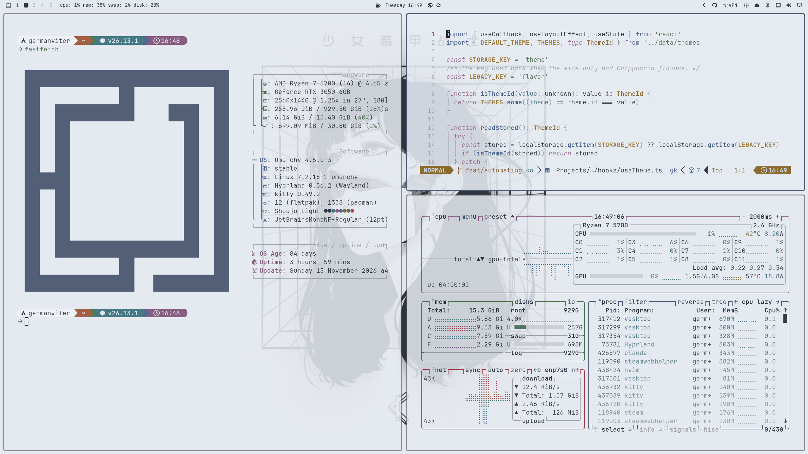

# Shoujo Light

*少女装甲战士 — slate-ink linework on frosted paper.*

A calm, paper-toned light theme for [Omarchy](https://omarchy.org). Cool frosted backgrounds, slate-ink text and muted jewel-tone syntax colors, built around the light Shoujo wallpaper.

Looking for the nighttime version? See [Shoujo Dark](https://github.com/GermanViter/omarchy-shoujo-dark-theme).



## Installation

Pick one:

**Terminal**

```
omarchy theme install https://github.com/GermanViter/omarchy-shoujo-light-theme.git
```

On Omarchy 3.x the command is `omarchy-theme-install` with the same URL.

**Omarchy menu**

1. Copy: `https://github.com/GermanViter/omarchy-shoujo-light-theme.git`
2. Open the Omarchy menu (`SUPER + SPACE`), go to **Install > Style > Theme**
3. Paste and hit enter

## What's Included

Everything Omarchy themes, driven by one palette in `colors.toml`:

- Hyprland window borders, the Omarchy bar, menus, notifications and lock screen
- Terminals: Alacritty, Kitty, Ghostty and Foot
- Neovim, through [aether.nvim](https://github.com/omacom/aether.nvim)
- btop
- Chromium, Chrome, Brave and Edge (browser toolbar color, light mode)
- Helix, VS Code, Obsidian, tmux and GTK apps (switched to light mode)
- `Yaru-blue` icons
- Wallpaper

Works on Omarchy 4.x and 3.x. `colors.toml` carries both the named palette that 4.x reads and the `color0`–`color15` keys that 3.x templates expect. VS Code and tmux theming need Omarchy 4.x. The empty `light.mode` file tells Omarchy 3.x to switch GTK and the browser to light mode (4.x reads `mode = "light"` from `colors.toml`).

> On Omarchy 4.x, installing prints `Ignored in ...: neovim.lua`. That is expected: Omarchy doesn't load Lua from themes installed with git, so it rebuilds Neovim's config from `colors.toml` and you get the same colors. `neovim.lua` is still included for Omarchy 3.x.

## Palette

| Role | Hex |
| --- | --- |
| Background | `#e5e9f0` |
| Foreground | `#2e3440` |
| Accent | `#4c5a73` |
| Selection | `#c9ced8` |
| Red | `#a3434f` |
| Orange | `#a35a3c` |
| Yellow | `#8a6a2a` |
| Green | `#4f7350` |
| Cyan | `#3f7580` |
| Blue | `#4a6491` |
| Magenta | `#85587d` |

## License

[MIT](LICENSE)
